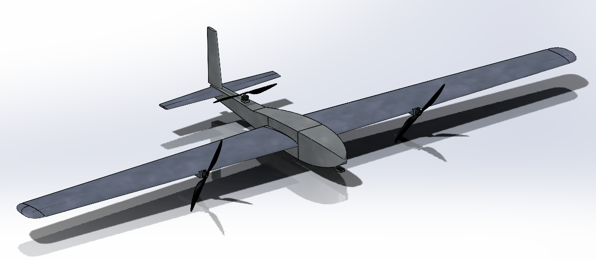
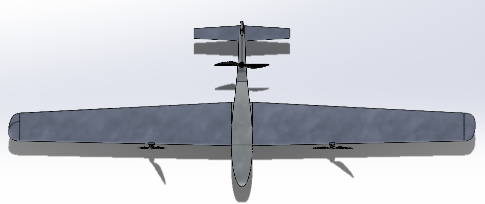
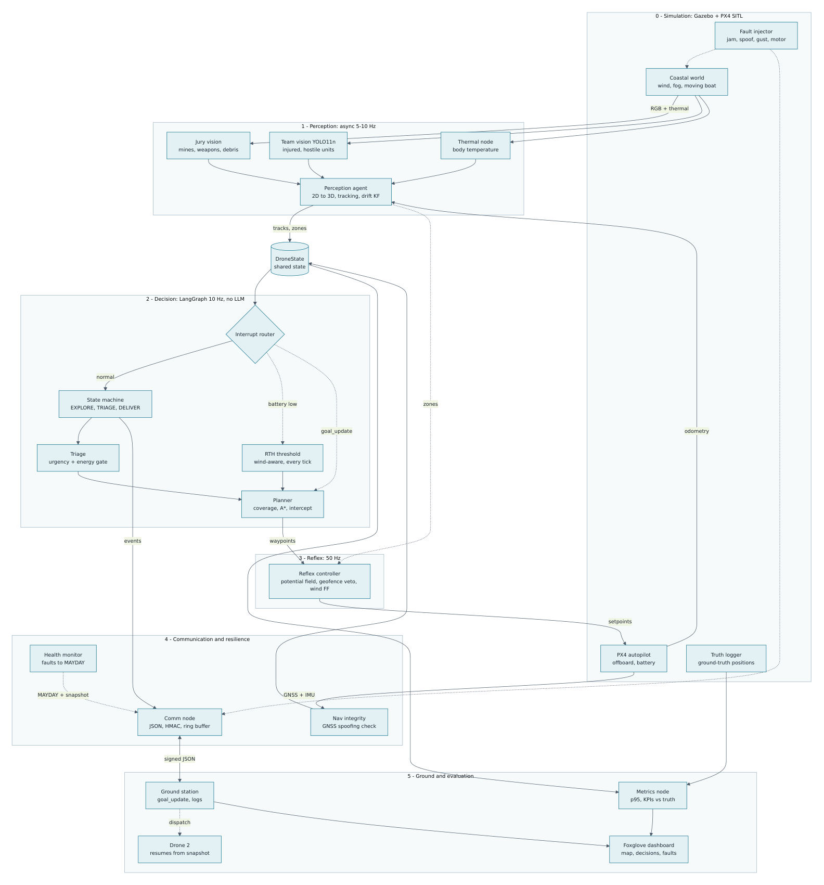
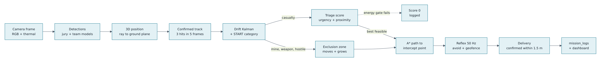
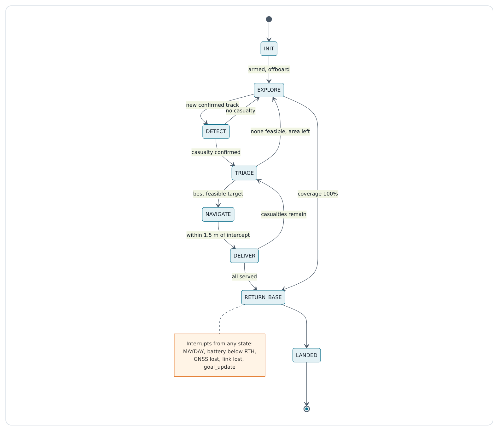
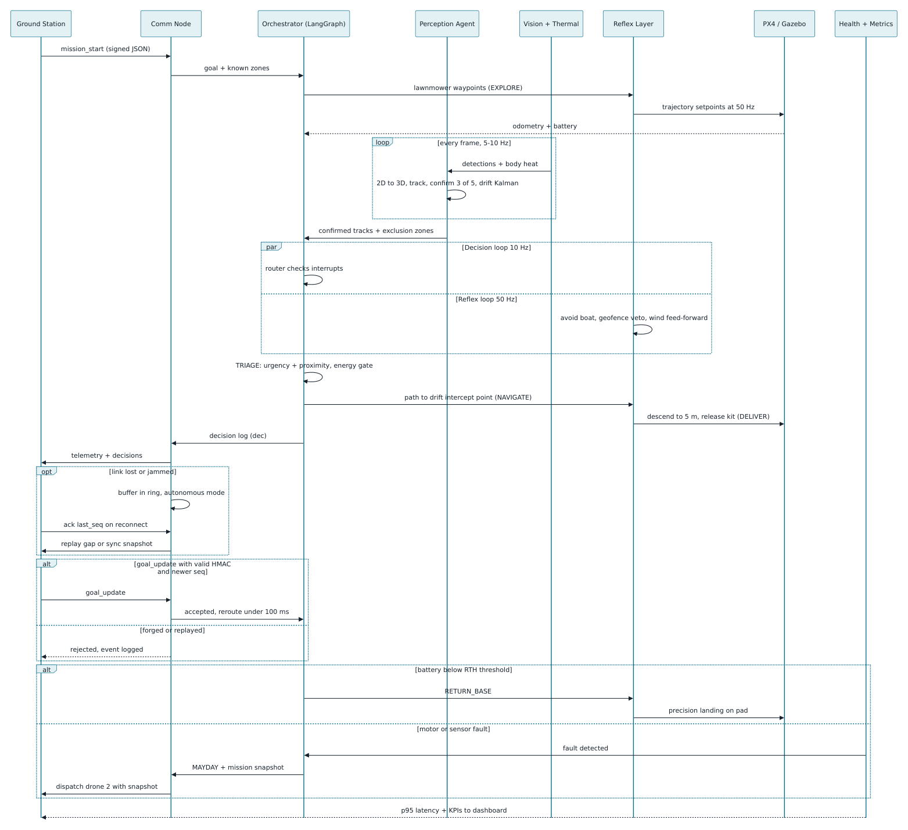
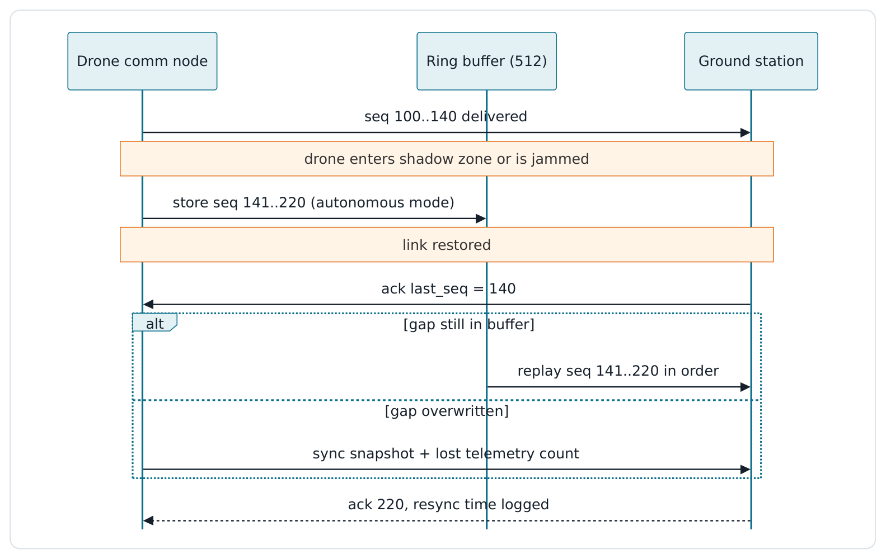
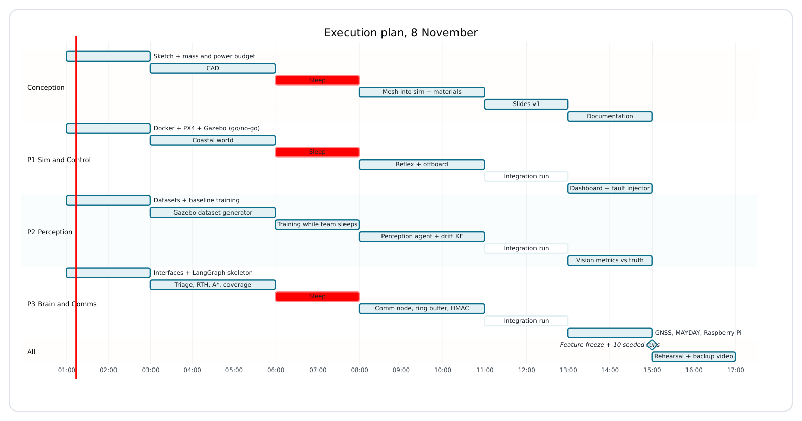

<p align="center">
  
</p>

<p align="center">
  <a href="docs/TECHNICAL_DOCUMENTATION.md"></a>
  <a href="https://raw.githack.com/mohamedazizabbes/DRONATHON3.0/main/docs/slides/deck.html"></a>
  <a href="docs/SKYFORGE_System_Design.pdf"></a>
  <a href="docs/INTERFACES.md"></a>
  <a href="deploy/raspberry_pi/README.md"></a>
</p>

<p align="center">
  
  
  
  
  
  
</p>

<p align="center"><i>The deck also lives at <a href="docs/slides/deck.html"><code>docs/slides/deck.html</code></a>: download and open it in a browser.</i></p>

---

**SKYFORGE** is an autonomous reconnaissance and rescue drone for a coastal disaster zone, built for **Dronathon 3.0** (IEEE AESS/RAS ENSIT, Tunis, 7–8 November 2026). With no human input, it:

- explores the coast and maps mines, weapons and debris;
- finds casualties and ranks them with a **thermal (FLIR) START triage**;
- avoids hostile units and obstacles;
- drops medical kits on the right person, **even someone drifting at sea**;
- survives jamming, GNSS spoofing, forged commands and motor failure;
- comes home before its battery runs out.

> **No human touches the drone. Every decision is a formula, and every decision is explained in the mission log.**

## ✦ At a glance

| | Result *(10 seeded missions, headless simulator)* | Spec |
|---|---|---|
| 🛡️ Collisions · danger-zone entries · off-target drops | **0 · 0 · 0** | penalties |
| 🚑 Living casualties served | **4.8 / 5** (7 runs perfect) | all feasible |
| 🔋 Landing battery · RTH energy prediction | **≥ 20%** (reserve 15%) · **−2.8 … +7.8%** | dynamic RTH |
| 🎯 Kit drop error | **≤ 0.96 m** (mean 0.30 m) | < 1.5 m |
| ⚡ Decision · reflex latency (p95) | **≤ 6.4 ms · < 0.3 ms** | ≤ 100 · < 50 ms |
| 📡 Messages · losses through outages | **< 1 KB · 0 lost** | < 1 KB |
| 🛰️ GNSS spoof detection · forged commands | **1.9 s · 100% rejected** | |

## ✦ The drone

<p align="center">
  
  
</p>

- **Airframe:** a fixed-wing **VTOL** (SolidWorks; exported to Gazebo). A long-endurance wing, two tilting wing rotors plus a rear pusher, and a T-tail.
- **Sensors:** a gimbal with RGB + radiometric thermal camera, **tilted 20° forward** (it sees mines ~31 m ahead, beyond their 15 m danger radius), a boom magnetometer, and a winched dipping sonar.
- **Payload:** a medical kit with an **IR strobe**, so served casualties are recognisable in FLIR.
- **Companion computer:** a Raspberry Pi running the communication module.

## ✦ How it works

<p align="center"></p>

| Layer | Rate | What it does |
|---|---|---|
| **PerceptionAgent** | 5–10 Hz, async | fuses the jury model (mines, weapons, debris) + team model (casualties, hostiles) + magnetometer + sonar → 3D tracks, drift Kalman filters, START triage, danger zones |
| **LangGraph orchestrator + PlannerAgent** | 10 Hz, no LLM | interrupt router → state machine (EXPLORER, DÉTECTER, TRIAGE, NAVIGUER, LIVRER, RETOUR BASE, POSÉ, MAYDAY) → energy-gated triage, A* around zones, drift intercept, path-aware RTH |
| **Reflex** | 50 Hz | follows the path, avoids the moving boat, **hard veto** on danger zones, wind feed-forward, returns home alone on critical battery |
| **Comm** (Raspberry Pi) | events | signed JSON < 1 KB, 512-message ring buffer, ordered replay and resync, MAYDAY snapshot to drone 2 |

<p align="center"></p>

**What makes it smart:**

- **Triage:** `S = 0.7·urgency·confidence + 0.3·proximity`, and **0 if the battery can't go there and come back**. Every candidate and the reason it lost are logged.
- **FLIR triage:** injured first. *Likely deceased* requires skin at ambient temperature, no breathing for 8 s at close range, and being on land: that casualty gets no kit and is reported for recovery. In water, cold skin means hypothermia, so the casualty is IMMEDIATE.
- **Drift:** a Kalman filter per floating object, plus an online sea-current estimator, so the drone flies to where the person *will be*.
- **Mines in three layers:** camera (surface), magnetometer dipole inversion (shallow and buried), dipping sonar (deep). Checks are always made from **outside** the danger circle, and weak cues are verified or rejected.
- **Return home:** energy is recomputed every tick along the real path home, with wind, and the power model is **self-calibrated** from the battery drain.
- **Resilience:**
  - jamming → autonomous mode + replay;
  - GNSS spoofing → inertial navigation in < 2 s;
  - forged / replayed commands → rejected;
  - motor failure → MAYDAY → drone 2 resumes from the snapshot.

<details>
<summary><b>📐 System design diagrams</b>: state machine, mission sequence, link-loss resync, execution plan</summary>

#### State machine


#### Mission sequence


#### Link loss and resync


#### Execution plan


</details>

## ✦ Quick start

**1. Full mission without ROS** (any OS, Python ≥ 3.10):
```bash
pip install numpy pyyaml langgraph matplotlib pytest
cd skyforge_ws/src/skyforge_core
python -m skyforge_core.sim.run --out runs/demo        # decision feed, metrics, trajectory + mission map
python -m skyforge_core.sim.run --mayday-at 150        # motor failure -> MAYDAY -> drone 2 takes over
python -m pytest tests -q                              # 42 core tests (+1 ROS graph test in ../skyforge_ros/test)
```

**2. Gazebo Harmonic simulation** (Docker, with the operator HUD and the trained detectors):
```bash
docker compose -f docker/compose.yaml build
tools/run_sim.sh gpu 7                                 # or: tools/run_sim.sh cpu   (ONNX models)
```

**3. ROS 2 Jazzy on the host** (PX4 offboard or velocity-controlled model):
```bash
cd skyforge_ws && git clone -b release/1.15 https://github.com/PX4/px4_msgs.git src/px4_msgs
colcon build && source install/setup.bash
ros2 launch skyforge_bringup mission.launch.py backend:=px4 \
     jury_model:=$PWD/../models/jury.onnx team_model:=$PWD/../models/team.onnx
```

**4. Raspberry Pi communication module (F12):** see [`deploy/raspberry_pi`](deploy/raspberry_pi/README.md).

**Demo controls:**
- `curl -X POST localhost:8080/goal -d '{"type":"goto","p":[120,40]}'` → the drone reroutes in the same tick;
- `/forge` and `/replay` → rejected;
- faults on `/skyforge/fault_cmd`: `jam`, `spoof`, `gust`, `motor`.

Details are in the [technical documentation §15](docs/TECHNICAL_DOCUMENTATION.md#15-build-run-and-deploy).

## ✦ Repository

| Path | Contents |
|---|---|
| [`skyforge_ws/src/skyforge_core`](skyforge_ws/src/skyforge_core) | **all the logic, pure Python**: LangGraph orchestrator, PerceptionAgent, PlannerAgent, energy / RTH, reflex, comm + security, monitors, 2D mission simulator, tests |
| [`skyforge_ws/src/skyforge_ros`](skyforge_ws/src/skyforge_ros) | ROS 2 nodes (orchestrator, perception, reflex/PX4, comm, monitors, fault injector, vision, viz, obstacle relay) |
| [`skyforge_ws/src/skyforge_sim`](skyforge_ws/src/skyforge_sim) | Gazebo Harmonic coastal world, VTOL model, bridge, mover / weather / payload / HUD / report nodes |
| [`skyforge_ws/src/skyforge_interfaces`](skyforge_ws/src/skyforge_interfaces) · [`skyforge_bringup`](skyforge_ws/src/skyforge_bringup) | ROS 2 messages · launch files and the single parameter file |
| [`vision/`](vision) · [`models/`](models) | dataset, training, evaluation, export and scene-generation pipeline · trained YOLO11 detectors (`.pt`, `.onnx`) |
| [`deploy/raspberry_pi`](deploy/raspberry_pi) · [`docker/`](docker) · [`tools/`](tools) | Pi comm bridge · Jazzy and simulation images · one-command sim launch, report viewer |
| [`docs/`](docs) | [technical documentation](docs/TECHNICAL_DOCUMENTATION.md), [interfaces](docs/INTERFACES.md), [architecture notes](docs/ARCHITECTURE.md), [system design PDF](docs/SKYFORGE_System_Design.pdf), [slides](docs/slides/deck.html), diagrams, CAD |

## ✦ Team

| Role | Scope |
|---|---|
| Brain & communications | architecture, LangGraph orchestrator, PerceptionAgent and PlannerAgent, reflex, comm + security, Raspberry Pi, 2D simulator, tests |
| Vision & simulation | jury and team detectors (datasets, training, evaluation), Gazebo Harmonic world, HUD, mission report |
| Conception | VTOL airframe (SolidWorks), sensors, payload, power budget |

<p align="center"><sub>Built for Dronathon 3.0 · IEEE AESS/RAS ENSIT Student Branch Chapters · Tunis 2026. The results above are simulator measurements; see the <a href="docs/TECHNICAL_DOCUMENTATION.md#16-verification-and-validation">validation section</a>.</sub></p>
