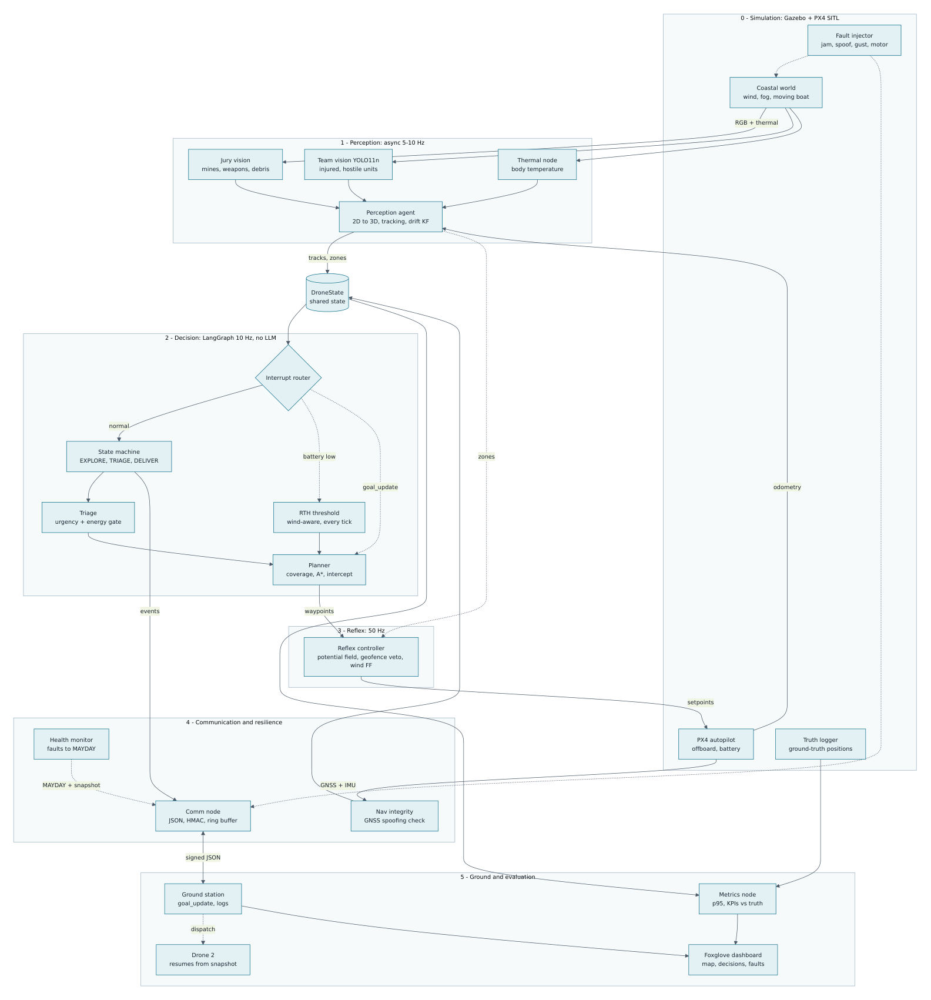
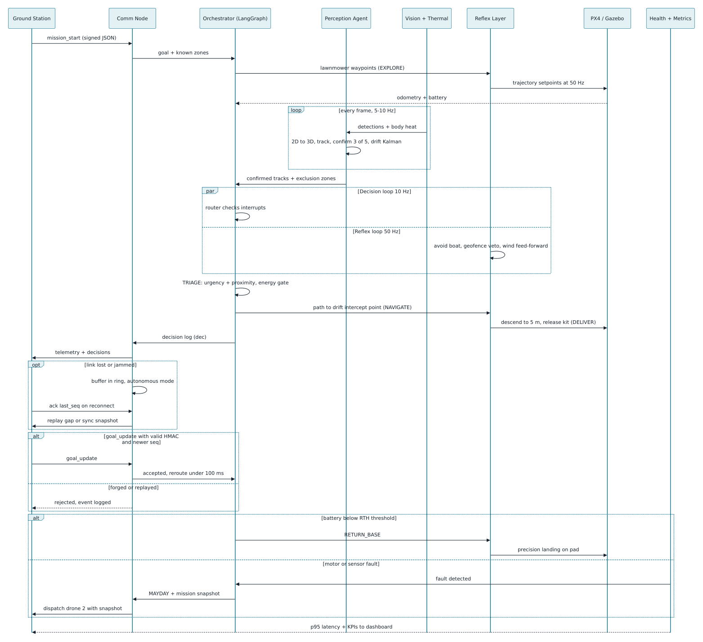
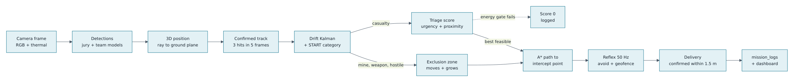
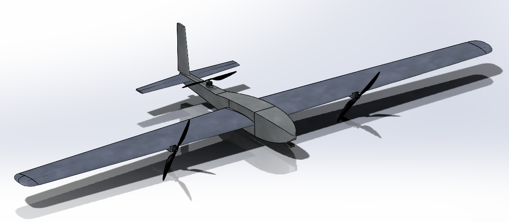
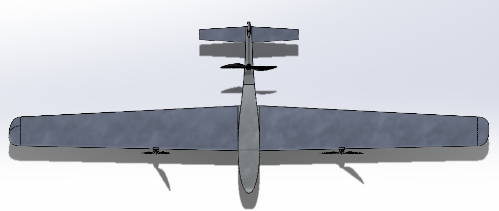
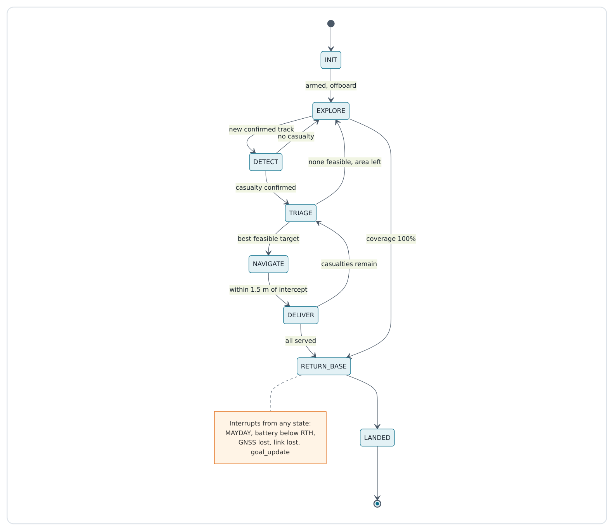
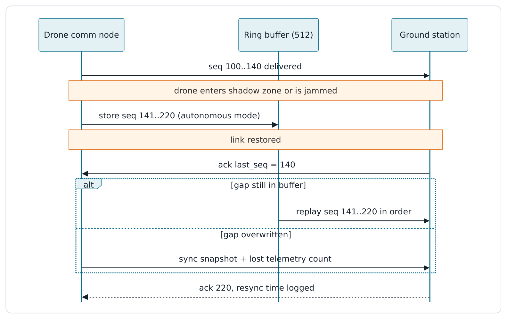

<p align="center"></p>

# SKYFORGE: Technical Documentation

**Dronathon 3.0 · Mission SKYFORGE** · IEEE AESS/RAS ENSIT Student Branch Chapters · Tunis, 07–08 November 2026

| | |
|---|---|
| Repository | `mohamedazizabbes/DRONATHON3.0` (branch `main`) |
| Stack | ROS 2 Jazzy · Gazebo Harmonic · PX4 SITL (or velocity-controlled model) · Python 3.10+ · LangGraph · YOLO11 |
| Demo video | [youtube.com/watch?v=5pZ2y8-tONc](https://www.youtube.com/watch?v=5pZ2y8-tONc) |
| Companion documents | [README](../README.md) · [Interfaces](INTERFACES.md) · [Architecture notes](ARCHITECTURE.md) · [Original system design (PDF)](SKYFORGE_System_Design.pdf) · [Slides](slides/deck.html) · [Raspberry Pi guide](../deploy/raspberry_pi/README.md) |

---

## Contents

1. [Executive summary](#1-executive-summary)
2. [Mission and requirements](#2-mission-and-requirements)
3. [System overview](#3-system-overview)
4. [Drone conception](#4-drone-conception)
5. [Software architecture](#5-software-architecture)
6. [Decision layer: LangGraph orchestrator](#6-decision-layer-langgraph-orchestrator)
7. [PlannerAgent](#7-planneragent)
8. [PerceptionAgent](#8-perceptionagent)
9. [Reflex layer](#9-reflex-layer)
10. [Communication, security and the Raspberry Pi](#10-communication-security-and-the-raspberry-pi)
11. [Resilience and fault handling](#11-resilience-and-fault-handling)
12. [Vision models](#12-vision-models)
13. [Simulation](#13-simulation)
14. [Configuration reference](#14-configuration-reference)
15. [Build, run and deploy](#15-build-run-and-deploy)
16. [Verification and validation](#16-verification-and-validation)
17. [Limitations and future work](#17-limitations-and-future-work)

---

## 1. Executive summary

SKYFORGE is an autonomous reconnaissance and rescue drone for a coastal disaster zone, built as a ROS 2 system. Without any human input, it:

- explores the area and maps mines, weapons and marine debris;
- finds casualties and ranks them by medical urgency (thermal START triage);
- avoids obstacles, hostile units and danger zones;
- drops medical kits on the right person, including people drifting at sea;
- keeps the mission going through radio jamming, GNSS spoofing, forged commands and hardware failure;
- returns home before its energy runs out.

Three design principles:

1. **Deterministic, explainable decisions.** A LangGraph state graph of pure-Python nodes, with no language model in the real-time loop. Every decision is a formula whose inputs, outputs and rejected alternatives are written to `mission_logs`.
2. **Safety by layers.** A 50 Hz classical reflex layer vetoes any motion into a danger zone independently of the 10 Hz decision layer. Energy is checked against a path-aware, self-calibrating model at every tick.
3. **One logic, many runtimes.** All logic lives in a pure-Python package (`skyforge_core`) that runs unchanged in the ROS 2 nodes, the Gazebo simulation, the headless 2D simulator and 43 automated tests.

Key results (headless simulator, 10 seeded missions, see §16):

- **0 collisions, 0 danger-zone entries, 0 off-target drops**;
- 4.8 / 5 living casualties served;
- every mission landed, with ≥ 20% battery against a 15% reserve;
- drop error ≤ 0.96 m (spec: 1.5 m);
- decision latency p95 ≤ 6.4 ms (spec: 100 ms).

---

## 2. Mission and requirements

### 2.1 Mission (spec §1)

Explore a simulated coastal zone. Detect mines, weapons and marine debris. Locate and prioritise casualties. Avoid hostile units and obstacles. Deliver simulated medical supplies. Communicate with a ground station (including during outages). Return safely to base. No human intervention.

### 2.2 Hard constraints

| Constraint | Requirement | How it is met |
|---|---|---|
| Real time | reflex < 50 ms, decision ≤ 100 ms, total ≤ 150 ms (p95) | reflex < 0.3 ms, decision ≤ 6.4 ms (measured with `perf_counter_ns` on every tick); perception runs asynchronously |
| No LLM in the loop | LangGraph with deterministic nodes | `brain/orchestrator.py` builds a `StateGraph` of pure functions; a dict-dispatch FSM runs the same functions, and a test proves the decisions are identical |
| Humanitarian payload | no weapon, hostile units are zones to avoid, never targets | hostile units only create exclusion and line-of-sight zones; there is no targeting code path |
| Messages | compact JSON < 1 KB, version + sequence number, declared buffer capacity | asserted at encode time; ring buffer of 512 messages |

### 2.3 Functional requirements traceability

| Ref. | Requirement (spec §5) | Implementation | Evidence |
|---|---|---|---|
| F1, F2 | Autonomous navigation, exploration, mapping; wind compensated | lawnmower coverage + 2 m coverage grid (`planning/coverage.py`), A* (`planning/astar.py`), wind feed-forward in the reflex, end-of-mission map (`mission_map.py`) | coverage 78–93% of the reachable area per mission (lanes inside zones are skipped); `mission_map.json/.png` |
| F3, F4 | Detection of debris, mines, weapons, danger zones | jury model + 3-layer mine detection (camera, magnetometer, dipping sonar) fused in the PerceptionAgent; zones recorded | mines localised 4.3/5, covered by a zone 4.6/5 (§16) |
| F5 | Detection of casualties and hostile units, compliant JSON | team YOLO11 model (5 classes) → canonical JSON (`docs/INTERFACES.md` §1) | adapter tests |
| F6 | Prioritisation: urgency first + proximity, 0 if no energy to go and return; traced | `planning/triage.py` + `planning/agent.py`; every candidate is logged with its components | `test_triage_urgency_dominates_and_energy_gate` |
| F7 | Delivery on the right target | intercept point, release gate (offset + 0.5σ ≤ 1.0 m, fresh, steady, GNSS trusted, 3 ticks), retry rounds, kit marking | 0 off-target drops in all regressions |
| F8 | Obstacle avoidance and replanning; zero collision / zero zone entry | inflated hard zones in A*, reflex hard veto, potential field for the moving boat, descend-last / climb-first | 0 / 0 in all regressions |
| F9, F10 | Communication and operation without link; < 1 KB; logs resynchronised | `comm/` package: HMAC, sequence + boot id, priority ring buffer, ordered replay, sync snapshots | outage tests: 0 messages lost |
| F11 | Return home triggered by a dynamic threshold | path-aware, wind-aware, self-calibrating `E_RTH`, recomputed every tick | prediction error −2.8…+7.8%, landing ≥ 20% |
| F12 | Bonus: communication module on a board | standalone comm bridge (stdlib only) + systemd service + benchmark | `deploy/raspberry_pi/` |

### 2.4 State machine (spec §7)

`INIT → EXPLORER → DÉTECTER → TRIAGE → NAVIGUER → LIVRER →` back to `TRIAGE` while casualties remain, otherwise `RETOUR BASE → POSÉ`. Priority interrupts: battery below threshold (return home), link lost (autonomous mode), goal changed (reroute). SKYFORGE adds a `MAYDAY` state for hardware faults. French labels are used in every log and on the dashboard.

---

## 3. System overview

### 3.1 Component map



### 3.2 Layers and timing

| Layer | Rate | Responsibility | Measured |
|---|---|---|---|
| Perception (PerceptionAgent) | 5–10 Hz, asynchronous | pixels → 3D tracks, drift, START triage, danger zones, mine fusion | ~1–6 ms per frame (excluding CNN inference) |
| Decision (LangGraph orchestrator + PlannerAgent) | 10 Hz + immediate tick on `goal_update` | state machine, interrupts, triage, paths, return home | p95 ≤ 6.4 ms |
| Reflex | 50 Hz | path following, obstacle repulsion, hard zone veto, wind feed-forward, critical-battery return, stale-plan hold | p95 < 0.3 ms |
| Communication | event driven | signed JSON, ring buffer, replay, sync, MAYDAY fragments | < 1 ms per message |

### 3.3 Mission sequence



### 3.4 From pixel to delivery



---

## 4. Drone conception

<p align="center">
  
  
</p>

The airframe is a **fixed-wing VTOL**:
- a high-aspect-ratio wing for endurance;
- two tilting wing-mounted rotors and a rear pusher for vertical take-off, hover and transition;
- a slim fuselage carrying the payload bay and a T-tail.

The SolidWorks assembly is exported to Gazebo (`skyforge_sim/models/skyforge_drone`; conversion script `vision/scripts/cad_to_gz.py`).

The software depends on these conception choices. Each one was derived from a failure observed in simulation:

| Item | Requirement | Reason |
|---|---|---|
| Camera gimbal | RGB + radiometric thermal, **tilted 20° forward** of nadir | a nadir camera at 25 m sees only ~16 m ahead, barely more than a mine's 15 m safety radius; 20° gives ~31 m look-ahead |
| Medical kit pod | servo latch, drag chute, **IR strobe on the kit** | the strobe makes served casualties identifiable in FLIR, so no second kit is ever dropped after drift |
| Magnetometer | fluxgate on a boom away from the motors (~0.15 nT noise), 10 Hz | mine layer 2 (shallow / buried mines) |
| Dipping sonar | winched transducer, ~60 m range, used while hovering at 3 m over water | mine layer 3 (deep mines) |
| Navigation | dual IMU, GNSS, optical flow, rangefinder | dead reckoning when GNSS is jammed or spoofed |
| Comms | main radio + companion computer (Raspberry Pi) | F12 bonus, resilience |
| Materials | carbon-fibre structure, fibreglass radome (RF-transparent), marine coating | coastal operation, GNSS / radio through the radome |
| Energy budget | `p_hover_w`, `k_speed`, `capacity_wh` measured (60 s hover + 60 s cruise) | feeds the energy model; online calibration corrects the remaining error |
| Identification | humanitarian markings, beacon and strobe | protected status depends on being identifiable |

---

## 5. Software architecture

### 5.1 Repository layout

```
skyforge_ws/src/
  skyforge_core/        all logic, pure Python (no rclpy): brain, perception, planning, energy,
                        reflex, comm, monitor, sim (2D simulator), mission_map, tests/
  skyforge_interfaces/  ROS 2 messages (Detection, Track, Zone, MissionState, MissionEvent, Metric, ...)
  skyforge_ros/         thin ROS 2 nodes + fake-rclpy closed-loop test
  skyforge_bringup/     mission.launch.py, config/skyforge.yaml (single parameter file), faults_demo.yaml
  skyforge_sim/         Gazebo Harmonic world, VTOL model, bridge, mover/weather/payload/HUD/report nodes
vision/                 dataset building, training, evaluation, export, simulated scene generation
models/                 trained detectors: jury.(pt|onnx), team.(pt|onnx)
deploy/raspberry_pi/    comm bridge install script, systemd service, F12 guide
docker/                 Jazzy image, simulation image, compose services
tools/                  run_sim.sh (one-command Gazebo launch), report_viewer.py
docs/                   this document, interfaces, architecture notes, diagrams, CAD, slides
```

### 5.2 ROS 2 nodes

| Node | Package | Role |
|---|---|---|
| `orchestrator_node` | skyforge_ros | LangGraph tick at 10 Hz; immediate tick on `goal_update`; publishes the path, mission state and events, releases, MAYDAY snapshots, sonar / magnetic commands; writes `mission_log_*.jsonl` and the mission map |
| `perception_agent_node` | skyforge_ros | fuses `/vision/jury` and `/vision/team` (JSON), `/sensors/mag`, `/sensors/sonar`; publishes tracks, zones, provisional zones, sonar and magnetic requests |
| `reflex_node` | skyforge_ros | 50 Hz reflex + vehicle interface (PX4 offboard over XRCE-DDS, or `/cmd_vel` twist backend); the only NED↔ENU conversion point |
| `comm_node` | skyforge_ros | comm bridge in-process (`mode:=local`) or forwarded to the Raspberry Pi (`mode:=pi`) |
| `health_node`, `nav_integrity_node`, `metrics_node` | skyforge_ros | fault detection → MAYDAY, GNSS spoofing / loss detection, latency percentiles |
| `fault_injector` | skyforge_ros | GNSS relay with spoof injection; jam / motor / gust faults (live or scripted) |
| `vision_node` ×2 | skyforge_ros | loads the jury / team detector (.pt / .onnx), publishes the canonical JSON; reads mean box temperature from the thermal camera |
| `viz_node`, `obstacle_relay` | skyforge_ros | Foxglove / RViz mission map; Gazebo model poses → `/skyforge/obstacles` |
| `mover_node`, `weather_node`, `payload_node`, `hud_node`, `report_node` | skyforge_sim | Gazebo: drift and moving boats, wind gusts and haze, falling kit, operator HUD, HTML mission report |

All topics, message fields and the link protocol are specified in [INTERFACES.md](INTERFACES.md).

### 5.3 DroneState

A shared `TypedDict` (`brain/state.py`) holding:
- **vehicle:** position, velocity, attitude, battery (Wh, %);
- **link and navigation:** link status and quality, GNSS status, navigation source;
- **environment:** wind, visibility;
- **world model:** casualties, zones (perception + station + handover), served / failed ids;
- **mission:** target, current goal, waypoints, phase, interrupts, RTH threshold, kits, energy calibration;
- **survey:** sonar / magnetic tasks;
- **output:** per-tick events.

---

## 6. Decision layer: LangGraph orchestrator

### 6.1 Graph

```
START → ingest → router ─(phase)→ <phase handler> ─(phase changed? ≤ 4 hops)→ <next handler> … → planner → END
```

- **ingest:** updates the coverage grid (footprint centre shifted forward by the camera tilt), the energy calibration and the dynamic RTH threshold.
- **router:** evaluates interrupts in priority order:
  1. MAYDAY (health fault);
  2. battery ≤ RTH threshold → `RETOUR BASE`;
  3. GNSS lost / spoofed → margins +5 m, RTH factor 1.5;
  4. link lost → autonomous flag;
  5. `goal_update` → applied in this tick;
  6. new or moved danger zone crossing the path → replan.
- **phase handlers:** INIT, EXPLORE, DETECT, TRIAGE, NAVIGATE, DELIVER, RETURN_BASE, LANDED, MAYDAY. Instant transitions are chained inside one tick, so a confirmed IMMEDIATE casualty is targeted in the tick where it is confirmed.
- **planner:** delegates path planning to the PlannerAgent and re-plans only when the goal moves more than 3 m, the zones change, or a replan is requested.



### 6.2 Policies

| Policy | Behaviour |
|---|---|
| `hybrid` (default) | only IMMEDIATE casualties interrupt exploration; the others are served after coverage, in score order. An **energy-aware rescue trigger** serves pending casualties earlier when the battery approaches 1.8× what serving the best one would cost |
| `immediate` | every confirmed casualty interrupts exploration (literal reading of the spec diagram) |
| `after_coverage` | explore everything first, then serve in score order |

Other rules:
- A MAYDAY handover drone serves inherited casualties immediately.
- An operator `goto` keeps priority over the hybrid pre-emption while it is active.
- After coverage, pending casualties are served **before** survey tasks (people first). Survey tasks only start with a comfortable energy margin.

### 6.3 Safety locks

- During MAYDAY or a battery-forced return, only `rtb`, `zone_add`, `zone_clear` and `weather` station commands are accepted.
- An aborted delivery pauses the casualty and retries later (3 rounds); only lost, unreachable or likely-deceased targets are permanent.
- Search legs and survey standoffs are never planned inside a zone.
- A goal without a path is skipped immediately; the drone never hovers waiting.

---

## 7. PlannerAgent

`planning/agent.py`: prioritisation, intercept, paths, energy and survey geometry.

### 7.1 Triage score (F6)

$$S_i = \begin{cases} 0.7\,U_i\,c_i + 0.3\,P_i & \text{if } f\cdot(E_{d\to i} + E_{deliver} + E_{i\to base} + E_{land} + E_{res}) \le E_{avail} \\ 0 & \text{otherwise}\end{cases}\qquad P_i = 1 - \frac{d_i}{d_{max}}$$

- U is the START urgency (§8.5), c the detection confidence, d the distance to the drift intercept point, f = 1.3 (1.5 without GNSS).
- The gate uses the same factor as RTH, so choosing a casualty never trips RTH right after the delivery.
- Excluded from triage:
  - duplicates of served casualties;
  - casualties seen next to a delivered kit (IR strobe);
  - likely-deceased casualties;
  - targets inside a zone.
- Ties go to the earliest detection.
- Each decision logs every candidate with `S, U, c, P, d, E, ok` and the reason it lost.

### 7.2 Paths

- **Coverage:** lawnmower lanes spaced at camera footprint × 0.8, on a 2 m coverage grid. Lane points inside zones are skipped.
- **A\*:** on a 2 m grid with 8-connectivity, no corner cutting and string-pull smoothing. Hard circles = zone radius + drone radius + safety margin + wind margin (+ low-visibility and no-GNSS extras). A hostile line-of-sight ring costs ×10.
- **Tiered margins:** hysteresis (+2 m) → nominal → minimum safe (drone radius + 1 m, still hard).
- **Escape:** if a zone appears on top of the drone, it takes the shortest way out first.

### 7.3 Intercept and search

The intercept point solves `p* = p(t) + v·(|p* − drone| / v_g)` with three fixed-point iterations. If the target isn't at its predicted position, the drone runs an IAMSAR expanding-square search sized by the track's σ, with legs filtered against zones.

### 7.4 Energy model and return home (F11)

The reflex commands a **ground** velocity, so the model does too:

$$v_{air} = \lVert v_g\,\hat u - w_{gust}\rVert \;(\le v_{air,max}),\quad P(v_{air}) = s\cdot p_{hover}\,(1 + k\,v_{air}^2),\quad E_{leg} = P\,\frac{d}{v_g}$$

$$E_{RTH} = E_{path\to home} + E_{climb} + E_{land} + E_{res},\qquad \text{RTH when } E_{avail} \le f\cdot E_{RTH}$$

- **Path-aware:** `E_path→home` follows the A* path home (refreshed every 2 s, never less than the straight line). A detour around zones had once landed a drone inside its reserve before this was added.
- **Climb:** `E_climb` covers returning to cruise altitude after a dip or delivery.
- **Calibration:** `s` is updated online every 5 s from the measured battery drain (EMA, bounded to 0.6–1.8). It converges to the airframe's real draw even if the paper power budget is off by 15–25%.
- **Critical battery:** the reflex has its own critical-battery return, independent of the brain.

### 7.5 Evasive manoeuvres

Threat-aware, never targeting:
- inside a hostile line-of-sight ring, the path first exits **radially** (shortest way out);
- A* then continues with the ×10 cost;
- waypoints still inside a ring fly at `evasive_alt` (15 m).

### 7.6 Survey tasks (mine layers 2 and 3)

- **Sonar stations:** spaced ~95 m over water.
- **Confirmation dips:** for tentative magnetic contacts in water.
- **Close magnetic inspections (10 m):** for tentative contacts on land.

Every task is flown from a **standoff ring around the contact** (submerged-mine radius + margin), never above it. The standoff is recomputed when zones move. Interrupted tasks restart their timeout, and a ping fires only at the task point.

---

## 8. PerceptionAgent

`perception/agent.py`

### 8.1 Detector adapter

`perception/adapter.py` accepts the canonical JSON and the usual variants:
- French keys (`classe`, `confiance`, `boite`);
- the lists `objets`, `objects`, `results`, `predictions`;
- normalised YOLO boxes.

Raw labels are mapped to SKYFORGE classes. The team posture classes add `posture` / `in_water` attributes.

### 8.2 From 2D to 3D

The bounding-box point (bottom-centre for objects, centre for people) becomes a ray through the camera intrinsics, the 20° gimbal tilt and the drone attitude, intersected with the ground or sea plane z = 0. Position σ grows with altitude, slant and attitude error.

### 8.3 Tracking

- **Association:** greedy nearest neighbour per class. The gate is `min(8 m, max(clamp(0.12·alt, 0.8, 3) m, 2·√(σ_track² + σ_det²)))`, never tighter than the wave motion for floating tracks. This prevents both identity splits and false-positive pile-ups at low altitude.
- **Confirmation:** 3 hits in 5 frames where the track should be visible, plus a minimum mean confidence (casualties 0.4, hostiles 0.35). Unconfirmed tracks die after 4 misses in view; non-visual contacts are exempt from camera misses.
- **Re-identification:** stale confirmed tracks are matched with a gate that grows with their uncertainty (up to 25 m on land, 90 m at sea). Water/land status must match, except at the shoreline.

### 8.4 Drift and the sea state

- **Constant-velocity Kalman filter** per track, state [x, y, vx, vy]. Floating tracks start from the drift prior `current + k_leeway·wind`; the velocity is bounded around the prior and has a variance floor, so σ grows honestly while unseen.
- **Sea-state estimator** (`perception/sea_state.py`): learns the surface current online from every observed floating track, inverse-variance weighted, with leeway removed.
- **Long-baseline learning:** a drifting object re-acquired after a gap gives displacement ÷ time, the mean drift over the gap. Unseen floating tracks are re-centred on the current estimate, which follows tide changes.

### 8.5 Thermal START triage

| Category | Evidence | U |
|---|---|---|
| IMMEDIATE | in water without flotation (**always**, cold skin = possible hypothermia), or warm + immobile > 10 s + lying | 1.0 |
| DELAYED | warm and moving while lying / sitting; or cool but moving | 0.7 |
| MINOR | warm, standing / waving | 0.3 |
| EXPECTANT | skin below the warm threshold, immobile | 0.1 |
| DCD (likely deceased) | on land, skin within 2 K of ambient, immobile, **no breathing micro-motion for ≥ 8 s at close range** | 0.0 |

- Post-mortem cooling (~1 K/h) cannot be measured in flight, so death is never inferred from a cooling rate.
- EXPECTANT targets get a 10 s assessment hover before release. A DCD never consumes a kit: its position is reported for recovery. The drone never declares death.
- Proximity to a mine raises a living category by one step.

### 8.6 Zones

- **Radius** = class safety distance (mine 15 m, submerged mine 12 m, weapon 10 m, hostile = declared detection radius, default 25 m) + min(2σ, 12 m) + 0.5 m per m/s of wind. Floating mine zones move with their filter.
- **Provisional zones** come from *unconfirmed visual* danger detections. They feed only the reflex (inward veto), so recall comes first without letting false positives push the drone around.

### 8.7 Mines in three layers

| Layer | Sensor | Finds | Processing |
|---|---|---|---|
| 1 | camera, jury model | surface, beach, floating | §8.2–8.3 |
| 2 | magnetometer (`perception/magnetic.py`) | shallow submerged / buried | background EMA → anomaly event (6σ) → **dipole inversion** (below) |
| 3 | dipping sonar | deep submerged | range / bearing / depth contacts → mine tracks; contacts on land discarded |

How the layer-2 dipole inversion works:
- a grid search over (x, y, depth), with the amplitude solved in closed form by weighted least squares;
- the model is `a ≈ A / r³`;
- σ ∝ distance / SNR;
- single-pass ambiguity is declared;
- the fields of already-explained sources are peeled off before fitting.

Fusion and verification:
- One mine track per mine records the layers that saw it and its depth.
- A magnetic anomaly on a known weapon is attributed to that weapon.
- Weak magnetic events are only **cues**. A close-range inspection or a sonar dip confirms or **rejects** them, and unconfirmed cues expire after 180 s.

---

## 9. Reflex layer

`reflex/controller.py`, `skyforge_ros/reflex_node.py`, 50 Hz:

1. **Waypoint following:** pure pursuit with a switching radius.
2. **Potential-field repulsion** from obstacles. Moving obstacles (the boat) are predicted 2 s ahead.
3. **Hard veto:** the inward velocity component is removed inside the buffer band of every danger zone, and the drone escapes radially if a zone appears on top of it. Provisional zones get the inward veto only. The operating area is geofenced.
4. **Wind feed-forward:** integral of the desired-minus-achieved velocity.
5. **Vertical rules:** climb before transit (after a delivery or dip) and descend last (keep cruise altitude, and so a large camera footprint, until above a lower target).
6. **Autonomy:**
   - critical battery → return home and land without the brain;
   - stale plan (brain silent > 1.5 s) → hold position.

Backends:
- **PX4:** velocity offboard (`TrajectorySetpoint`); setpoints are streamed for at least 1 s before switching to OFFBOARD and arming. PX4's EKF wind is republished on `/skyforge/wind`.
- **`twist`:** velocity-controlled Gazebo model, with the battery integrated from the energy model.

---

## 10. Communication, security and the Raspberry Pi



- **Message format:** compact JSON `{"v","seq","ts","b","t",…,"h"}`, always **< 1 KB** (asserted at encode time). Larger bodies (MAYDAY / sync snapshots) are fragmented automatically.
- **Signature:** `h` = HMAC-SHA256 over the canonical JSON, truncated to 8 bytes.
- **Replay protection:** the `seq` must be newer within the sender session `b` (boot id). A new session must also be newer in time.
- **Ring buffer (512 messages):**
  - unacked messages are kept, with telemetry evicted first and critical messages last;
  - on reconnect, untransmitted messages are replayed in order **proactively**;
  - the station's ack (`last`, `max`) triggers gap replay, or a `sync` snapshot plus lost counts if the gap was overwritten;
  - replays are debounced per message.
- **RTT:** NTP-style echo in the acks.
- **Jury station compatibility:** `comm.station_auth: none` accepts unsigned station messages and normalises foreign command layouts and names. Forgery protection is then off, and this is logged.
- **Raspberry Pi (F12):** the comm bridge runs standalone with the Python standard library only. A systemd service starts it at boot and caps it at 128 MB. `pi_bench` measures RSS, CPU, per-message latency, RTT, resync time and losses through a forced outage. Laptop reference: 23 MB, 0.5 ms p95 per message, 3 ms RTT, 0 lost. See [deploy/raspberry_pi](../deploy/raspberry_pi/README.md).

---

## 11. Resilience and fault handling

| Threat | Detection | Response | Measured |
|---|---|---|---|
| Radio jamming / shadow zone | link simulator, packet loss | autonomous mode, everything buffered, ordered replay on reconnect | 0 messages lost |
| GNSS spoofing | low-gain inertial reference + χ² innovation gate (5 consecutive) | reject GNSS, roll the estimate back to the reference, margins +5 m, RTH ×1.5, no blind release | 40 m ramp detected in 1.9 s |
| GNSS loss | fix timeout / satellites | dead reckoning, same margins | test |
| Forged / replayed command | HMAC + per-session sequence | rejected, `forged_rejected` / `replay_rejected` logged | 100% rejected |
| Motor / sensor / battery fault | motor saturation > 1 s, odometry timeout, voltage sag, overheating | **MAYDAY:** fragmented snapshot, controlled landing ≥ 10 m from casualties and outside zones | drone 2 resumes |
| Wind gust | wind estimate / station weather | RTH threshold and margins grow; reflex feed-forward | threshold jump visible |

**MAYDAY handover** (`brain/handover.py`, one code path for the simulator and ROS):
1. The station saves `mayday_snapshot.json`.
2. Drone 2 is launched with `resume_snapshot:=mayday_snapshot.json`.
3. It inherits the casualties (served ones kit-marked), zones, coverage and lane index, goes straight to TRIAGE, and serves the inherited casualties immediately.

---

## 12. Vision models

The detection models were built by the vision team member; the brain consumes their output through the JSON contract.

| Model | Classes | Training data | Files |
|---|---|---|---|
| **Jury module**, v4 (mines, weapons, debris) | `mine`, `weapon`, `debris` | Roboflow mines, Kaggle gun detection, Zenodo TUN-MarineLitter (polygons → boxes), an additional weapons set; 70 / 20 / 10 split; fine-tuned on frames matching the drone camera geometry | `models/jury.pt`, `models/jury.onnx` |
| **Team module F5**, v3 (casualties, hostiles) | `injured_lying`, `injured_sitting`, `person_standing`, `injured_water`, `hostile_unit` | simulator-generated scenes (`vision/simgen`, four generations), SeaDronesSee tiles (people in water), armed-person data; split by scene to avoid leakage | `models/team.pt`, `models/team.onnx` |

Pipeline:

| Step | Script |
|---|---|
| Dataset assembly with class maps | `vision/scripts/build_dataset.py` |
| Image tiling | `tile_dataset.py` |
| Training (Ultralytics YOLO11, 640 px) | `train.py` |
| Evaluation, per-class precision / recall at IoU | `evaluate.py` |
| ONNX export + latency benchmark | `export_bench.py` |
| Frame capture in the simulator | `sim_capture.py` |
| Scene generation | `vision/simgen/gen.py` |

`vision_node` runs either format, drops frames when busy (no stale queue), and reads the mean box temperature from the 16-bit thermal image (`thermal_scale`). Per-class metrics are produced by `vision/scripts/evaluate.py` on the 10% test split, with recall prioritised for mines and weapons (spec §4).

---

## 13. Simulation

### 13.1 Headless 2D mission simulator

`skyforge_core/sim` runs the complete brain (LangGraph orchestrator, both agents, reflex, nav integrity, health, comm with ring buffer, ground station) against a ground-truth world:

- **World:** 5 living casualties + 1 likely-deceased body; 5 mines (beach, floating, shallow 3 m, deep 12 m, buried); a weapon, a hostile unit, obstacles and a moving boat.
- **Sea:** waves (±0.6 m orbital motion) and a tide change.
- **Sensors:** a magnetometer with drift and clutter, a sonar with rock clutter, and an airframe drawing 15% more power than its paper budget.
- **Faults:** jam, GNSS spoof, forged / replayed / real commands, gust, optional motor failure → MAYDAY → drone 2.
- **Metrics** are computed against truth: collisions, zone entries (registered zones vs hidden mines), drop error, mines localised / covered, RTH prediction error, latency, comms.

### 13.2 Gazebo Harmonic world

`skyforge_sim` (built by the simulation team member):
- a coastal world generated from the same scenario (`make_world.py`): textured sea and sand, a deep-water band, hills and lagoon, trees and rocks outside the area;
- the team **VTOL model** with RGB and thermal cameras at the 20° tilt, spinning props and nav lights;
- the `ros_gz_bridge` configuration;
- `mover_node`: drift with waves, moving boats, `/skyforge/obstacles`, `/sim/truth`;
- `weather_node`: gusts on the vehicle, visibility haze;
- `payload_node`: a falling medical kit on every release;
- an operator **HUD** inside the Gazebo window: tactical map, ground-truth layer, found counters, target boxes;
- `report_node`: an **HTML mission report** on landing.

Launch: `tools/run_sim.sh [gpu|cpu] [seed]` (Docker image `skyforge:jazzy-sim`).

---

## 14. Configuration reference

Everything is tunable in **one file**, `skyforge_bringup/config/skyforge.yaml` (Gazebo: `skyforge_sim/config/skyforge_gazebo.yaml`). Missing keys fall back to `skyforge_core/params.py`. Most important keys:

| Key | Default | Meaning |
|---|---|---|
| `mission.area`, `home`, `cruise_alt`, `cruise_speed` | see file | operating area (ENU, metres from the pad), 25 m, 6 m/s |
| `mission.triage_policy` | `hybrid` | `hybrid` / `immediate` / `after_coverage` |
| `mission.kits`, `serve_deceased` | 4, false | payload; never spend a kit on DCD |
| `mission.release_offset_m`, `delivery_radius` | 1.0, 1.5 | release gate vs spec radius |
| `energy.capacity_wh`, `p_hover_w`, `k_speed`, `v_air_max` | 90, 180, 0.012, 16 | **from the conception power budget** |
| `energy.rth_factor`, `rth_factor_gnss_lost`, `reserve_frac` | 1.3, 1.5, 0.15 | RTH margins |
| `camera.tilt_deg`, `hfov_deg` | 20, 80 | gimbal tilt and field of view |
| `zones.safety.*`, `safety_submerged_mine` | 15 / 10 / 25, 12 | danger radii |
| `magnetic.*`, `sonar.*` | enabled | mine layers 2 and 3 (disable them if the sensors are absent) |
| `comm.key_hex`, `station_auth`, `ring_capacity` | demo key, `hmac`, 512 | **change the key for the competition** |
| `water.polygons`, `comm.shadow_polygons`, `obstacles` | scenario | put the jury's scenario here |

---

## 15. Build, run and deploy

### 15.1 No ROS: full mission in the 2D simulator

```bash
pip install numpy pyyaml langgraph matplotlib pytest
cd skyforge_ws/src/skyforge_core
python -m skyforge_core.sim.run --out runs/demo        # decision feed, metrics.json, trajectory.png, mission_map.png
python -m skyforge_core.sim.run --mayday-at 150        # motor failure -> MAYDAY -> drone 2
python -m skyforge_core.sim.run --seeds 10 --quiet     # regression -> aggregate.json
python -m pytest tests -q && python -m pytest ../skyforge_ros/test -q
```

### 15.2 Gazebo simulation (Docker)

```bash
docker compose -f docker/compose.yaml build            # skyforge:jazzy and skyforge:jazzy-sim
tools/run_sim.sh gpu 7                                  # Gazebo + HUD + full stack, detectors from models/
```

### 15.3 ROS 2 Jazzy on the host

```bash
cd skyforge_ws && git clone -b release/1.15 https://github.com/PX4/px4_msgs.git src/px4_msgs
pip install --break-system-packages langgraph ultralytics onnxruntime
colcon build && source install/setup.bash
ros2 launch skyforge_bringup mission.launch.py backend:=px4 team_model:=$PWD/../models/team.onnx jury_model:=$PWD/../models/jury.onnx
python3 -m skyforge_core.comm.station_server --config src/skyforge_bringup/config/skyforge.yaml
```

Launch arguments:
- `backend:=px4|twist`;
- `comm_mode:=local|pi` with `pi_host:=`;
- `vision:=true|false`, `viz:=true|false`;
- `fault_script:=…/faults_demo.yaml`;
- `resume_snapshot:=mayday_snapshot.json` (drone 2);
- `use_sim_time:=true` only if `/clock` is bridged.

### 15.4 Raspberry Pi

```bash
sudo ./deploy/raspberry_pi/install.sh --station <LAPTOP_IP> --brain <LAPTOP_IP>
python3 -m skyforge_core.comm.pi_bench --duration 60 --outage 30      # F12 measurements
```

### 15.5 Operating the demo

- **Faults:** `ros2 topic pub --once /skyforge/fault_cmd std_msgs/String '{data: "{\"type\":\"jam\",\"on\":true,\"dur_s\":20}"}'` (also `spoof`, `motor`, `gust`).
- **Station:**
  - `curl -X POST localhost:8080/goal -d '{"type":"goto","p":[120,40]}'`
  - `/forge` and `/replay` demonstrate rejection.
  - `/status` shows the station view.
- **Foxglove** (`ws://localhost:8765`):
  - 3D panel: `/viz/markers`;
  - RTH gauge: plot `/mission/state.battery_wh` vs `.rth_threshold_wh`;
  - decision feed: `/rosout`.

---

## 16. Verification and validation

### 16.1 Automated tests (43)

- **`skyforge_core/tests`:**
  - protocol: HMAC, size, fragments, replay guard, ring buffer, outage replay without storm, compatibility mode;
  - energy: headwind, calibration convergence, detour-aware RTH;
  - triage, A* (avoidance, escape), evasive exit;
  - perception: projection with tilt, detector adapter, confirmation, drift KF, sea state, long-gap re-identification;
  - FLIR / DCD rules, deceased never served;
  - mine layers: two-pass inversion, single-pass flag, weapon attribution, camera exemption, sonar geometry, phantom rejection;
  - reflex veto / hold / critical return, spoofing detection;
  - orchestrator: both engines identical, latency budget, livelock regression, handover;
  - mission map, and a full-mission smoke test asserting 0 collisions, 0 zone entries, 0 off-target and landing above reserve.
- **`skyforge_ros/test`:** the real ROS nodes run closed-loop on a fake rclpy bus against the 2D world, with a real UDP ground station. It checks kit release, goal_update delivery, forged rejection, spoofing detection, resync, the sonar layer through ROS, attribute transport and the Foxglove markers.

### 16.2 Mission regression (10 seeded runs, headless simulator)

| KPI | Result | Spec |
|---|---|---|
| Collisions / danger-zone entries / off-target drops | **0 / 0 / 0** | 0 / 0 / penalties |
| Living casualties served | 4.8 / 5 (7 runs perfect) | all feasible |
| Landed / battery at landing | 10/10, lowest 20.4% | ≥ reserve (15%) |
| RTH energy, predicted vs actual | −2.8% … +7.8% | dynamic threshold |
| Drop error vs truth | max 0.96 m, mean 0.30 m | < 1.5 m |
| Decision latency p95 / reflex p95 | ≤ 6.4 ms / < 0.3 ms | ≤ 100 / < 50 ms |
| GNSS spoof detection | 1.9 s | |
| Forged / replayed commands | 100% rejected | |
| Messages | max 978 B, 0 lost through outages | < 1 KB |
| Mines | localised (≤ 8 m) 4.3 / 5, covered by a registered zone 4.6 / 5 | |
| MAYDAY at t = 150 s | drone 1 lands safely; drone 2 resumes; 0 safety events | |

### 16.3 Defects found by simulation and fixed

The regression loop drove the design. Notable defects, all fixed and covered by tests or the regression:
- a nadir camera seeing less than a mine's radius ahead (→ 20° tilt);
- a tracker gate that grew with uncertainty and swallowed neighbours;
- duplicate kits after drift (→ re-identification + kit marking);
- RTH along a straight line instead of the real path (→ a landing inside the reserve);
- an EXPLORE/TRIAGE livelock;
- a sonar-clutter cue whose provisional zone blocked the landing pad;
- phantom magnetic mines confirmed by repeated weak evidence;
- two magnetic sources merged into one track;
- a ghost casualty from false positives during a low hover (→ altitude-scaled gate + confidence floor);
- identity splits from waves;
- track attributes lost across the ROS boundary (`Track.attrs_json`).

---

## 17. Limitations and future work

- **Validation scope:** results come from the headless simulator and the closed-loop ROS test. The Gazebo integration runs the same nodes, but the full regression has not been repeated in Gazebo or on hardware.
- **Buried mines** are the least reliable layer: magnetic localisation at cruise altitude can be ~10–15 m off before the close inspection, though usually still covered by its zone.
- **Unobserved drift:** floating objects that are never re-observed after a large current change keep a stale prediction (σ grows to reflect it).
- **Vision metrics:** per-class precision / recall / mAP must be reported from `vision/scripts/evaluate.py` on the official test split.
- **Future work:**
  - a live second drone in Gazebo;
  - swarm relay for radio coverage;
  - magnetometer and sonar sensors in the Gazebo world;
  - onboard thermal vital-sign estimation.
